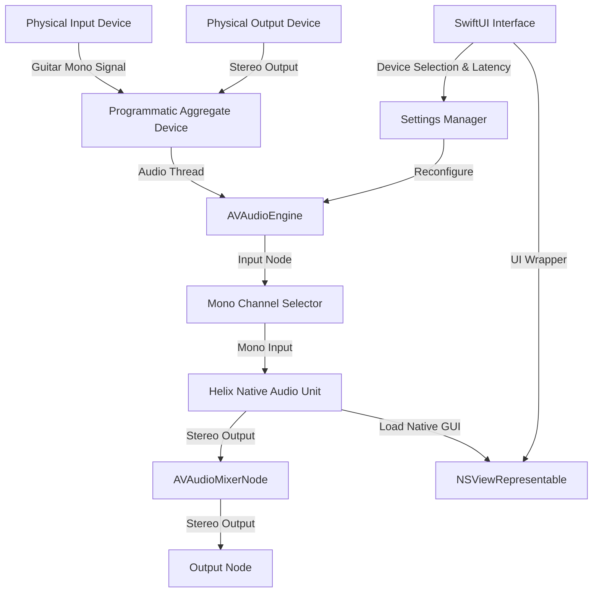

# HelixPlayer Design Specification

## Goal
The goal of HelixPlayer is to create a lightweight, high-performance, native macOS application that hosts the **Line 6: Helix Native** Audio Unit plugin. The application allows users to select separate physical audio input and output devices, routes a specific mono channel (guitar) through Helix Native, and outputs the processed stereo audio with minimal latency, ensuring a seamless live guitar playing experience.

---

## Architecture & Core Tech Stack
*   **Operating System**: macOS (native)
*   **User Interface**: SwiftUI (with AppKit bridging for Audio Unit views)
*   **Audio Engine**: AVFoundation (`AVAudioEngine`, `AVAudioUnit`, `AVAudioMixerNode`)
*   **Device Management**: CoreAudio HAL (C APIs bridged to Swift for querying audio devices and programmatically creating Aggregate Devices)
*   **Persistence**: `UserDefaults` for caching settings; local JSON state in `Application Support` for saving the Audio Unit's active preset/state.
*   **Background Behavior**: `ProcessInfo` activity assertions and CoreAudio real-time threads to prevent CPU throttling and system sleep during performance.

---

## Core Systems

### 1. Audio Engine & Programmatic Aggregate Device
*   **Problem**: `AVAudioEngine` runs on a single hardware device. Selecting separate physical inputs (e.g., a USB interface) and outputs (e.g., Mac Headphone Jack) natively fails or exhibits drift.
*   **Solution**: 
    1.  When different input and output devices are selected, the application queries their UIDs via CoreAudio.
    2.  It calls `AudioHardwareCreateAggregateDevice` to create a virtual aggregate device named "HelixPlayer Aggregate".
    3.  It sets `kAudioSubDeviceDriftCompensationKey` to `1` (enabled) on the drift sub-device.
    4.  It assigns the aggregate device ID to the output node of `AVAudioEngine` (`kAudioOutputUnitProperty_CurrentDevice`).
    5.  Upon application termination or device reconfiguration, the aggregate device is programmatically destroyed using `AudioHardwareDestroyAggregateDevice`.

### 2. Audio Unit (Helix Native) Hosting
*   **Plugin Identification**:
    *   Type: `kAudioUnitType_MusicEffect` (`aumf`)
    *   Subtype: `6HPA`
    *   Manufacturer: `LSIX`
*   **Instantiation**: Loaded asynchronously using `AVAudioUnit.instantiate(with:options:completionHandler:)`.
*   **Signal Routing**:
    *   A custom mono channel extractor node (using a tap or channel map array) extracts the selected guitar input channel (e.g., Channel 2).
    *   It routes this mono signal into the input of Helix Native.
    *   Helix Native's stereo output connects to the engine's main mixer, which outputs to the selected output channels.

### 3. User Interface (SwiftUI)
*   **Layout**:
    *   **Left Control Panel (Sidebar)**:
        *   Input Device selector dropdown (filtered to devices with >0 input channels).
        *   Input Channel selector dropdown (updates dynamically based on the selected device's channel count).
        *   Output Device selector dropdown (filtered to devices with >0 output channels).
        *   Buffer Size (Latency) selector (32, 64, 128, 256 samples).
        *   Bypass Switch (toggles bypass on the `AVAudioUnit` node).
        *   Volume VU meters (Input Peak level, Output Peak level).
        *   Panic / Mute Button (silences output instantly).
        *   Active Engine Indicator (visual LED showing running status).
    *   **Main Viewport**:
        *   Displays the native editor GUI of Helix Native using `NSViewControllerRepresentable`.
        *   If the plugin is loading, displays a sleek progress ring.

### 4. Background Execution & Sleep Prevention
*   To prevent audio dropouts when the app window is closed or in the background:
    *   The app registers a `ProcessInfo.processInfo.beginActivity(options: [.userInitiated, .idleSystemSleepDisabled], reason: "Live Audio Hosting")` assertion when the engine is running.
    *   Entitlements: Sandbox is disabled (`com.apple.security.app-sandbox` is set to `false`) to ensure Helix Native can load its license, presets, and write temporary files.
    *   `NSMicrophoneUsageDescription` is set in the `Info.plist` to prompt for audio interface input.

---

## Future Revisions (Phase 2)
These features are scoped out of the initial MVP but are designed to be easily integrated later:
1.  **MIDI Foot Controller Routing**: Listening for MIDI CC/PC inputs using CoreMIDI and sending them directly to Helix Native via `musicDeviceMIDIEvent`.
2.  **Backing Track Player**: A file-drop target with playback speed/volume controls routed directly to the mixer node.

---

## Testing Plan

### 1. Automated Tests (Unit Tests)
We will build a test suite under `HelixPlayerTests` targeting:
*   **CoreAudio Utilities**: Test parsing 4-character codes (OSType conversion), filtering devices (inputs vs outputs), and checking for sample rate matching.
*   **Settings Persistence**: Validate that `UserDefaults` loads, caches, and defaults selected device UIDs and buffer sizes safely.
*   **Audio Graph Construction**: Verify the audio routing node linkages, channel mappings, and connection format conversions.

### 2. Manual Verification
*   **Plugin Detection**: Verify that Helix Native loads successfully. If not found, falls back to Apple's built-in delay unit (`AUDelay`, `aufx`, `dely`, `appl`) with a visual warning.
*   **I/O Switch Test**: Plug in an audio interface, verify that we can select it as the input and select macOS Built-in output, and verify that the programmatic aggregate device is created/destroyed successfully.
*   **Latency validation**: Test playing guitar through the host at 32, 64, and 128 samples to verify low latency without crackling/dropouts.
*   **Persistence validation**: Close the app, re-open it, and verify that it restores both the device configuration and the Helix Native preset/knob state.
